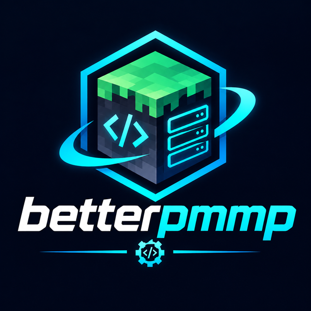

<p align="center">
  
</p>

<p align="center">
  <b>A vanilla game engine for PocketMine-MP 5.</b><br>
  Developed by <b>Leon Development</b><br>
  <a href="https://betterpmmp.github.io/Betterpmmp/"><b>Website & documentation</b></a> ·
  <a href="https://betterpmmp.github.io/Betterpmmp/plugins.html">Plugin development</a> ·
  <a href="https://github.com/BetterPMMP/Betterpmmp/releases">Download</a><br>
  Minecraft: Bedrock Edition 1.26.60 · Java Edition players through the built-in bridge · PocketMine plugins keep working
</p>

<p align="center">
  <a href="https://github.com/BetterPMMP/Betterpmmp/releases"></a>
  
  
  
  
</p>

---

PocketMine-MP is fast and has a great plugin API, but as a game it is mostly empty: no redstone, a flat
world generator, mobs that stand around, no structures, and a lot of blocks that do nothing when you
right-click them. That is fine for minigames. It is not fine if you want people to play survival.

BetterPMMP keeps everything PocketMine is good at (network layer, world storage, the plugin API) and puts
a vanilla game engine on top of it. You get 1.18+ terrain, villages and strongholds, redstone, mob AI,
the Nether and the End with their bosses, and Java Edition players can join the same server.

> **Beta.** A lot works like vanilla, but not every detail matches the official Bedrock server yet.
> [`VANILLA-PARITY.md`](VANILLA-PARITY.md) lists the state of every system, honestly. Back up your
> worlds before you switch.

## Contents

- [Why BetterPMMP](#why-betterpmmp)
- [Features](#features)
- [Installation](#installation)
- [Java Edition players](#java-edition-players)
- [Configuration](#configuration)
- [Custom items, blocks and creatures](#custom-items-blocks-and-creatures)
- [What's new](#whats-new)
- [Known issues](#known-issues)
- [Building from source](#building-from-source)
- [License](#license)

## Why BetterPMMP

- **Vanilla gameplay.** Most PocketMine-based servers are an empty shell. BetterPMMP plays like vanilla:
  mob AI with pathfinding, the Nether with 3D biomes and the End with their bosses, 1.18+ world generation
  with cave biomes, redstone and the vanilla commands.
- **Smooth performance.** Multithreading where it counts: world generation, chunk sending and mob path finding
  run in worker threads, so the main thread stays free for the game tick. Even with many players and mobs the
  server stays stable.
- **Java and Bedrock together.** Java Edition players join the same world through the built-in bridge,
  no extra setup.
- **Your plugins keep working, even old ones.** BetterPMMP keeps the PocketMine-MP 5 API (5.51.0), and plugins
  written for API 3 and 4 load in a compatibility mode that adapts their code automatically.

## Features

**World generation**
- Terrain like 1.18+: height −64 to 319, deepslate, 50+ biomes from multi-noise, mountains, rivers, all ocean types
- Cheese, spaghetti and noodle caves, lush caves, dripstone caves, the deep dark, geodes, fossils
- Villages (five styles, all job sites), mineshafts, strongholds, temples, outposts, monuments, mansions,
  ancient cities, trail ruins, shipwrecks, ruined portals, **trial chambers**
- Nether with five biomes, fortresses and bastions; the End with pillars, outer islands, end cities and ships

**Dimensions and bosses**
- Nether and End portals, eyes of ender, end gateways, elytra
- Ender dragon fight with crystals, flight phases and exit portal; the Wither

**Redstone**
- Dust, repeaters, comparators, torches, observers, pistons and sticky pistons, hoppers, dispensers, droppers
- Rails with real minecart physics, crafter, sculk sensors, target blocks, lightning rods

**Mobs**
- A* pathfinding, natural spawning with vanilla caps and biome tables
- Melee and ranged combat, creepers, witches, endermen that carry blocks, pillager patrols, the warden, the breeze
- Breeding, taming, riding (horses, pigs, striders, camels, the happy ghast), leads
- Villager professions and trading

**Commands like vanilla**
- Target selectors `@a @p @r @s @e @n` with filters, usable in plugin commands too
- `/execute`, `/scoreboard`, `/gamerule` (all 38 rules), `/setblock`, `/fill`, `/clone`, `/summon`,
  `/tellraw`, `/function`, `/structure`, `/camera`, `/schedule` and more

**Graphics**
- Vibrant Visuals for Bedrock players (shadows, water, lighting)
- Camera presets, fog and HUD control

The full list is in [`FEATURES.md`](FEATURES.md) (English and German).

## Installation

You need a 64-bit Windows, Linux or macOS machine.

**1. Get the PHP binary.** BetterPMMP runs on the same PHP build as PocketMine-MP, with the pmmp extensions.
Download the one for your system from
[pmmp/PHP-Binaries](https://github.com/pmmp/PHP-Binaries/releases) and unpack it into an empty folder.
You should end up with a `bin` folder.

**2. Get BetterPMMP.** Download `BetterPMMP-5.86.phar` from the
[latest release](https://github.com/BetterPMMP/Betterpmmp/releases) and put it next to the `bin` folder.

```
my-server/
├── bin/
└── BetterPMMP-5.86.phar
```

**3. Start it.**

Linux and macOS:

```bash
./bin/php7/bin/php BetterPMMP-5.86.phar
```

Windows (in the server folder):

```
bin\php\php.exe BetterPMMP-5.86.phar
```

The setup wizard asks for the language, server name and port, like PocketMine-MP does. After that the server
creates `server.properties`, `pocketmine.yml`, `betterpmmp.yml` and the `worlds` and `plugins` folders.

**4. Join.** Bedrock players connect to your IP on port **19132** (UDP). Java players use port **25565** (TCP),
see below.

### Moving from PocketMine-MP

Stop the server, back up the `worlds` folder, and replace the PocketMine phar with the BetterPMMP phar.
Plugins and worlds stay where they are. For the new terrain, structures and biomes, start with a new
world. Java/Anvil worlds are converted the first time they are loaded.

## Java Edition players

BetterPMMP ships a bridge based on [ViaProxy](https://github.com/ViaVersion/ViaProxy) and ViaBedrock. On the first
start it downloads Java and ViaProxy by itself and starts them in the background. Java players connect to
port 25565 and play on the same world as Bedrock players.

Open TCP **25565** (game) and TCP **25566** (resource packs) in your firewall or router. If you already have
Java installed, set `java-path` in `betterpmmp.yml`.

Java players can use crafting, furnaces, brewing stands, hoppers, chests and the smithing table.
Some windows are still missing, see [known issues](#known-issues).

## Configuration

Everything BetterPMMP adds is in `betterpmmp.yml`. The file explains every option. The important ones:

```yaml
graphics:
  vibrant-visuals: true      # let Bedrock players turn on Vibrant Visuals

java-bridge:
  enabled: true              # false = no Java players
  port: 25565
  auto-download: true        # download Java and ViaProxy automatically
  online-mode: true          # only real (bought) Java accounts
  name-prefix: "J_"          # Java players show up as J_Steve
  memory: "512M"             # memory for ViaProxy
  resource-pack-port: 25566  # 0 = don't send packs to Java players
  public-address: ""         # empty = detect the public IP
```

Game rules are set in game with `/gamerule` and are saved in each world's `level.dat`, so they behave like
on the official server.

## Custom items, blocks and creatures

You don't need a plugin to add content. On the first start BetterPMMP creates three files with commented
examples. Add your entries, drop the textures into the matching folder and restart. The textures and models
are packed into a resource pack and sent to Bedrock players automatically.

| File | Textures and models | What you can add |
|---|---|---|
| `custom_items.yml` | `custom_items/` | items, food, tools, armour |
| `custom_blocks.yml` | `custom_blocks/` | full blocks with one texture or top/side/bottom textures, light, hardness |
| `custom_entities.yml` | `custom_entities/` | creatures with a Blockbench model, animations and natural spawning |

```yaml
# custom_items.yml
items:
  myserver:ruby_sword:
    name: "Ruby Sword"
    tool:
      type: sword
      tier: diamond
      attack: 8
      durability: 2000
```

```yaml
# custom_blocks.yml
blocks:
  myserver:ruby_block:
    name: "Ruby Block"
    texture: ruby_block.png
    hardness: 5
    tool: pickaxe
```

Give or place them like any other item: `/give @s myserver:ruby_sword`, `/setblock ~ ~ ~ myserver:ruby_block`,
`/summon myserver:goblin`.

Don't rename or remove a block or creature that already exists in a world. It would turn into an unknown block
or be deleted.

## What's new

**5.86**
- Multi-API: plugins for API 3 and 4 load in compatibility mode (`plugins.legacy-api`). Their code is adapted on
  start (return types, `getLevel()`, `Item::get()` with numeric IDs, moved classes); see `plugin_cache/<Plugin>/changes.txt`

**5.85**
- 3D biomes in the Nether like vanilla: a cave can be a warped forest above a crimson forest
- Mob path finding runs in worker threads, in parallel with the world tick (`mob-ai.async-pathfinding`)

**5.84**
- Vanilla commands: target selectors, `/execute`, `/scoreboard`, all 38 game rules and 20 more commands
- Vibrant Visuals for Bedrock players
- Custom items, blocks and creatures from YAML files, with an automatic resource pack
- End cities built from the vanilla templates, with shulkers; elder guardians in monuments, witches in swamp huts
- Scheduled block ticks are saved with their chunks, so redstone and water continue after a restart
- Smithing table for Bedrock players: netherite upgrades and armour trims
- Endermen carry blocks, chicken jockeys, skeleton horse traps, beds explode in the Nether and End
- Skeletons aim and shoot like vanilla; mobs no longer ignore hits right after attacking
- Java players: furnaces, brewing stand, hoppers, dispensers, droppers, chest minecarts and boats, smithing table,
  fireworks, dyed leather armour, map and book copies
- Fixed a crash when water flowed into ungenerated terrain

Every version since the start is listed in [`VANILLA-PARITY.md`](VANILLA-PARITY.md).

## Known issues

- A redstone repeater problem was reported and is being looked into
- Bows and crossbows held by players were reported to behave oddly; also being looked into
- Java players can't open the anvil, enchanting table, grindstone, stonecutter, loom, cartography table,
  crafter, beacon or villager trading yet
- Bundles, nautilus armour and pottery sherd patterns on decorated pots don't work yet

[`AUDIT-ITEMS-BLOCKS.md`](AUDIT-ITEMS-BLOCKS.md) lists every block and item that is registered but has no
behaviour yet.

Found a bug? Open an [issue](https://github.com/BetterPMMP/Betterpmmp/issues) with the server log, your
BetterPMMP version and whether it happened on Bedrock or Java.

## Building from source

```bash
git clone https://github.com/BetterPMMP/Betterpmmp.git
cd Betterpmmp
php src/PocketMine.php
```

Use the PocketMine PHP binary from above. `vendor/` is committed on purpose, because several dependencies are
Axolotl-MP forks that are not on Packagist.

The Java bridge plugin lives in `tools/java-bridge-plugin` and is built with `build.sh <path to ViaProxy.jar>`.

More background on the bigger systems: [`BETTERPMMP-WORLDGEN.md`](BETTERPMMP-WORLDGEN.md) and
[`BETTERPMMP-REDSTONE.md`](BETTERPMMP-REDSTONE.md).

## License

BetterPMMP is developed by **Leon Development** and licensed under the LGPL-3.0-or-later, like PocketMine-MP, which it is based on.

BetterPMMP is not affiliated with Mojang Studios or Microsoft. Minecraft is a trademark of Mojang Studios.
