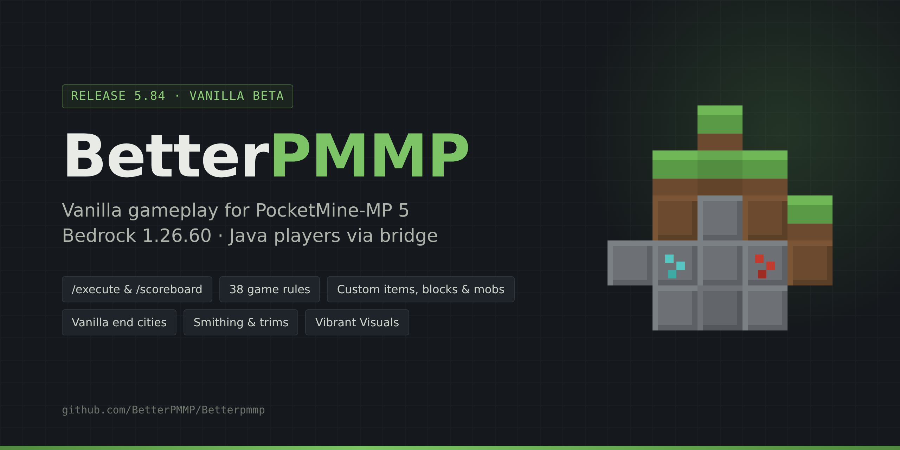

## BetterPMMP 5.85-vanilla-beta.1

PocketMine-MP 5 (API 5.51.0) based server for Minecraft: Bedrock Edition 1.26.60, with Java Edition players through the built-in bridge. Download `BetterPMMP-5.85.phar` below and start it like PocketMine-MP.

**Beta:** much of this release was only checked offline. Try it on a copy of your world first.

### New in 5.85

- **3D biomes in the Nether**, like vanilla: a cave can be a warped forest above a crimson forest. Floors, plants, fungus trees and vines follow the biome at their height. Nether chunks that already exist stay as they are.
- **Mob path finding in worker threads**: the A* search runs in parallel with the world tick, the main thread only copies the blocks around the mob. Switch: `mob-ai.async-pathfinding` in `betterpmmp.yml`.

### New since 5.67

**Commands like vanilla**
- Target selectors `@a @p @r @s @e @n` with all filters (`r`, `type`, `name`, `tag`, `m`, `c` …); `@a` runs a command for every player, plugin commands included
- `/gamerule` with all 38 Bedrock rules (keepInventory, doDaylightCycle, mobGriefing, randomTickSpeed …), saved in `level.dat`
- `/execute`, `/scoreboard`, `/setblock`, `/fill`, `/clone`, `/summon`, `/tellraw`, `/playsound`, `/tag`, `/function` (.mcfunction), `/daylock`, `/stopsound`, `/damage`, `/locate`, `/spreadplayers`, `/ride`, `/fog`, `/hud`, `/camera`, `/schedule`, `/tickingarea`, `/structure` (.mcstructure)

**Graphics:** Vibrant Visuals allowed for Bedrock players (`graphics.vibrant-visuals` in `betterpmmp.yml`)

**Custom content without plugins**
- `custom_items.yml`: items, food, tools, armour
- `custom_blocks.yml`: cube blocks
- `custom_entities.yml`: creatures with Blockbench models, animations and natural spawning
- Textures and models are sent as an automatically built resource pack

**World and mobs**
- End cities built from the vanilla templates, with shulkers; elder guardians in ocean monuments, witches in swamp huts
- Scheduled block ticks are saved with their chunks
- Endermen carry blocks, chicken jockeys, skeleton horse traps, beds explode in the Nether and End
- Skeletons shoot like vanilla; mobs no longer shrug off hits after attacking

**Items and blocks**
- Smithing table for Bedrock players (netherite upgrades, armour trims)
- Poplar doors and signs, kelp, straw beds, copper golem spawn egg, music discs Tears and Bounce work
- Moss with bone meal, leaf litter and wildflowers, plants need ground, poplar logs and leaves
- Full list of what works and what is missing: `AUDIT-ITEMS-BLOCKS.md`

**Java Edition players (bridge plugin 1.8.0)**
- Furnaces, brewing stand, hoppers, dispensers, droppers, minecarts with chest/hopper, chest boats, smithing table
- Fireworks, dyed leather armour, map and book copies

**Fixes**
- No crash when water flows into ungenerated terrain
- Old Java/Anvil worlds are converted when a plugin loads them

### Known issues
- Redstone repeater problem reported, still being investigated
- Java players: anvil, enchanting table, grindstone, stonecutter, loom, cartography table, crafter, beacon and trading do not open yet
- Bundles, nautilus armour, pottery sherd patterns on pots not implemented

Details for every version: `VANILLA-PARITY.md`.
